# Animal_Species_Detection
A code for detection animals based on their images to be used in wild.

# Persian Version 
در این ریپازیتوری کدی قرار دارد که براساس تصویر ورودی حیوانات می تواند تشخیص دهد ان حیوان چه نوع گونه جانوری است.

# Images
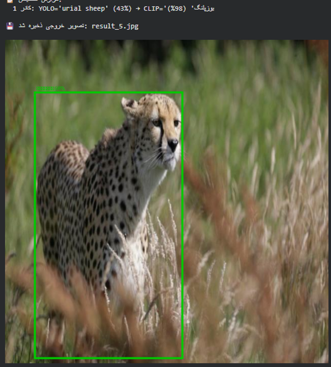
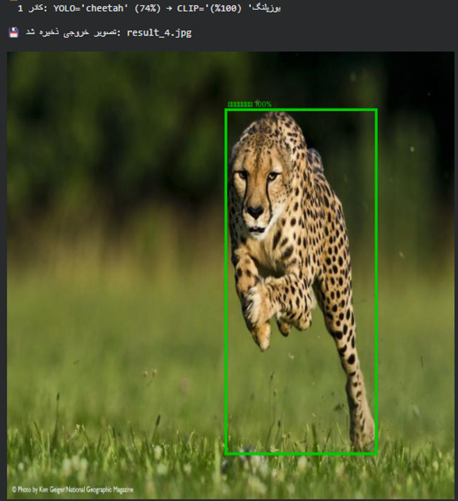
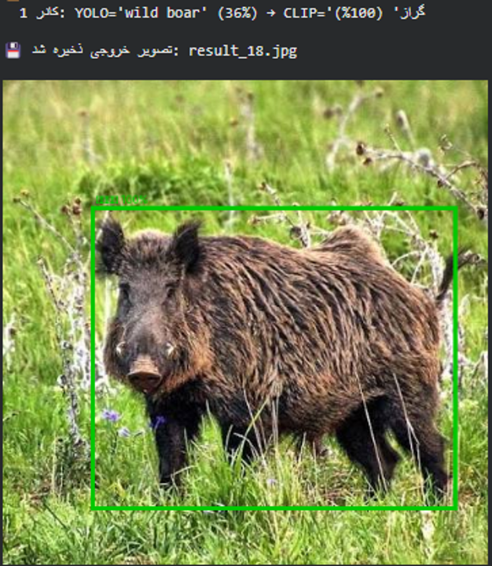
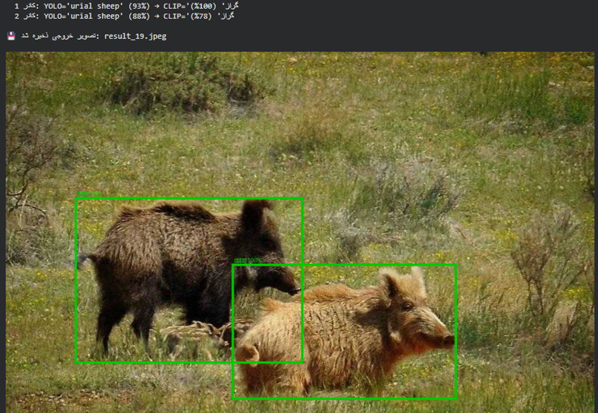
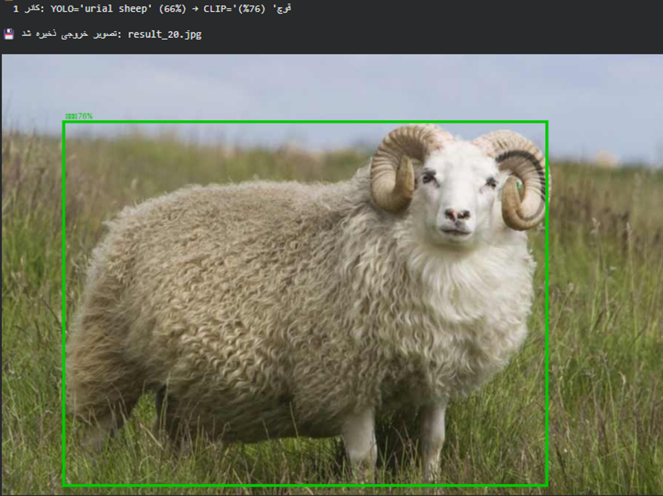
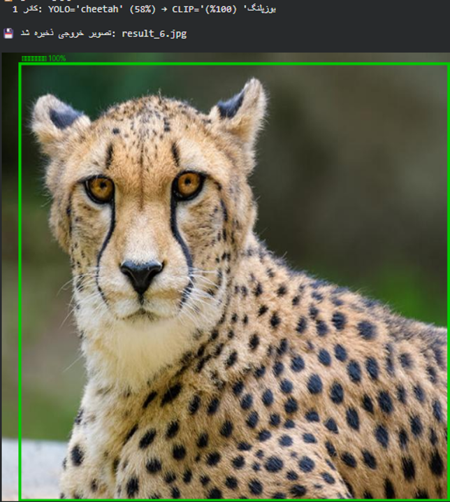
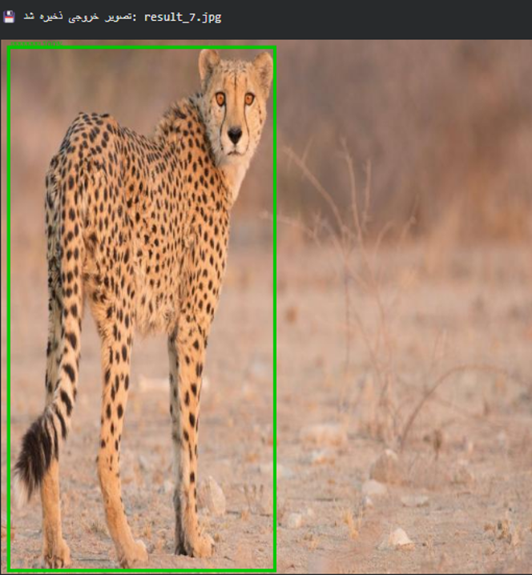
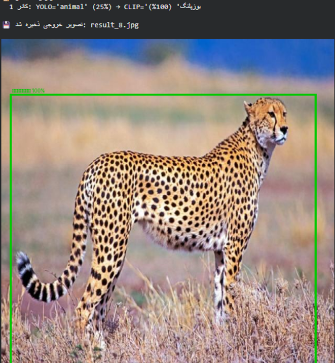
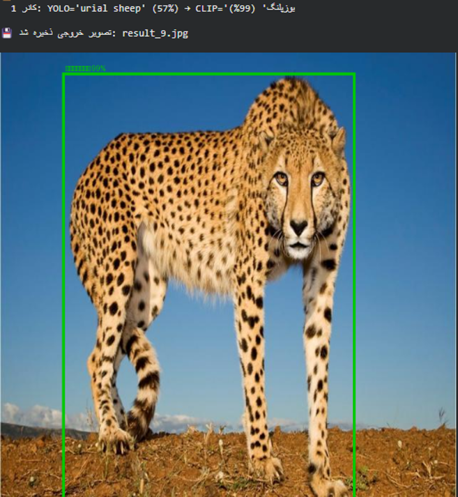
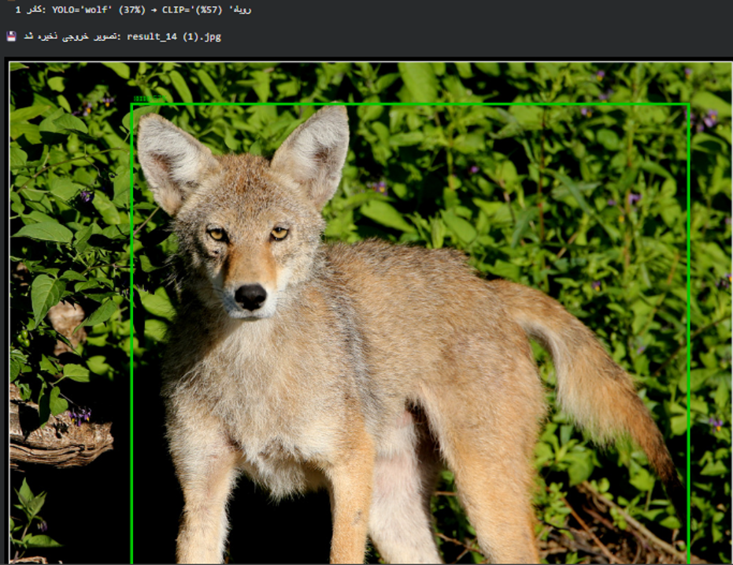
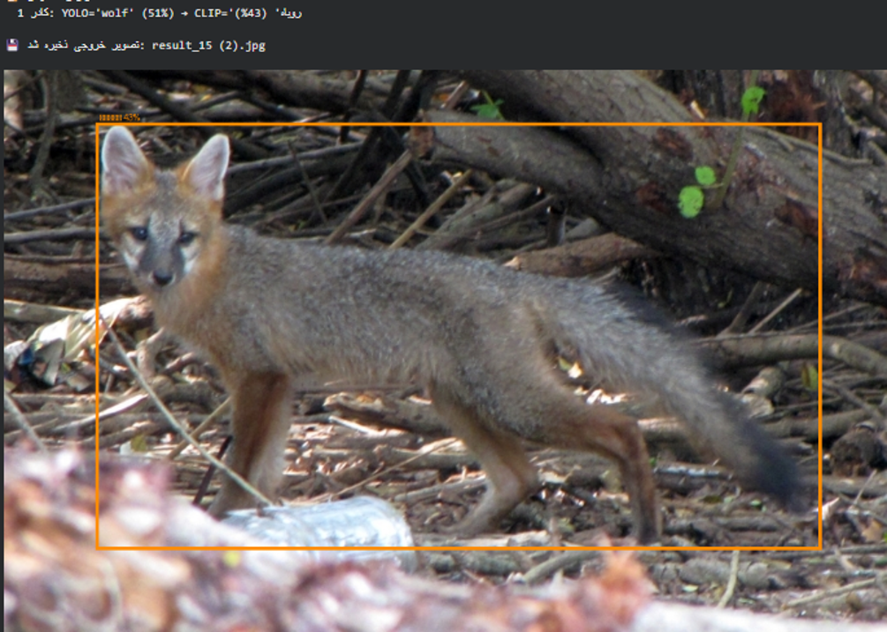
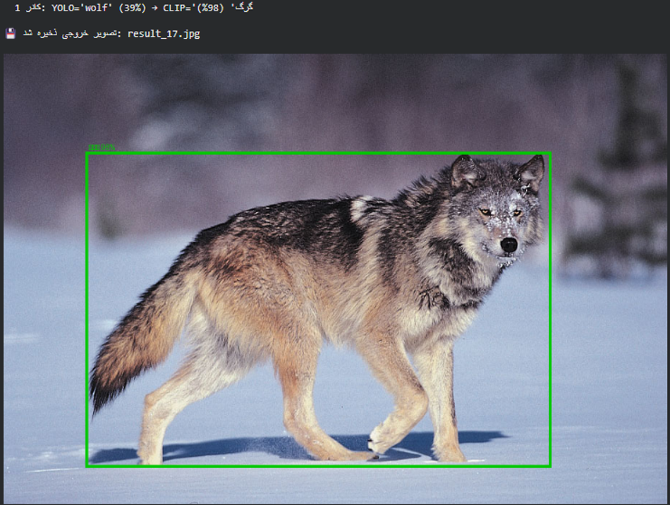
